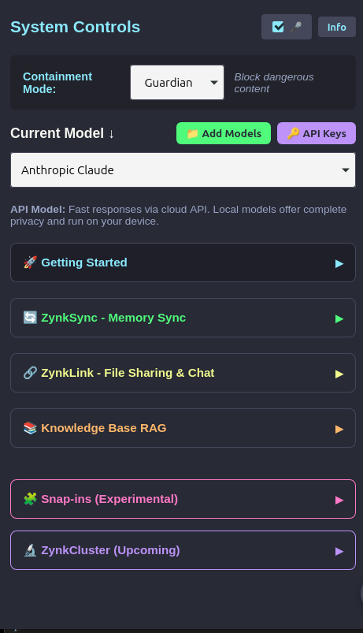
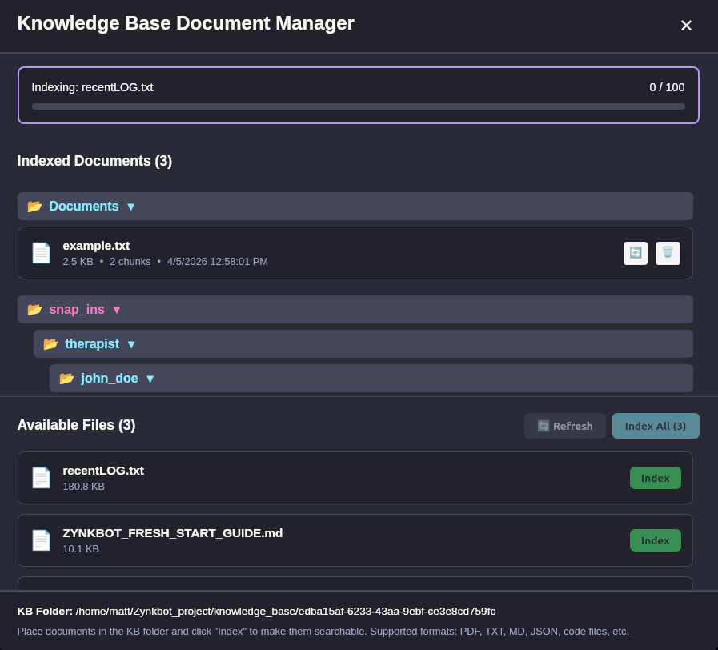
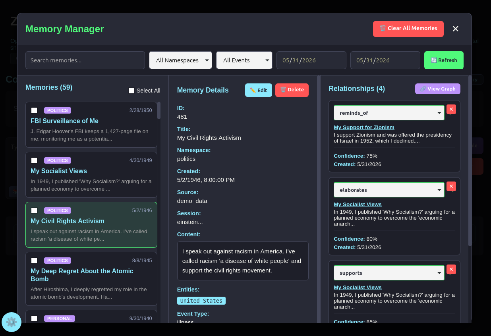
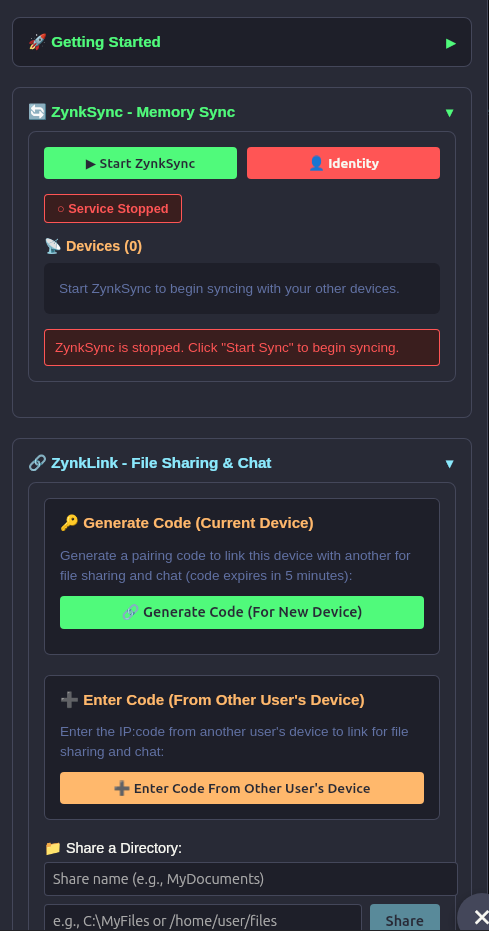
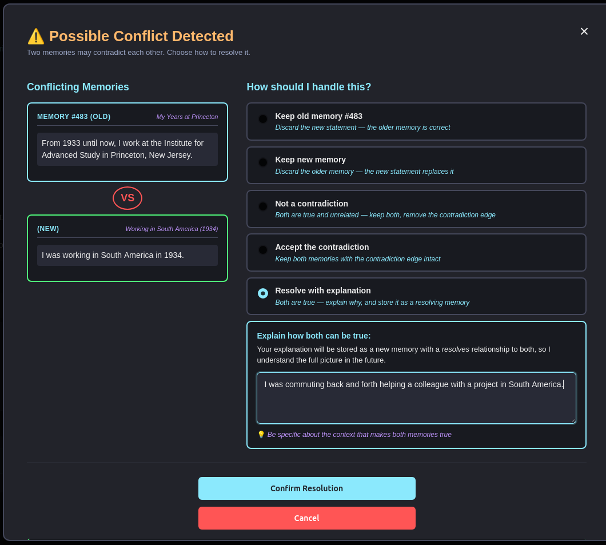

# Zynkbot Features Guide

**Comprehensive guide to all Zynkbot features and capabilities**

---

## Core Features

### 🧠 Persistent Semantic Memory

Zynkbot uses a local SQLite database for persistent, semantic memory that learns and grows over time.

**How it works (since 2026-10-24):**
1. After each reply, Zynkbot decides whether your message held a personal fact: a cloud model says yes or no in a hidden line at the end of its reply; a local model is asked directly in the next step
2. On yes, a separate background call lists the facts in the message, up to three, each with a title and the date it happened when you said one. Each fact becomes its own memory, written in the third person in your own words; your message is kept with it as what you said, never stored as a memory by itself
3. Each memory is embedded as a 384-dimensional vector and stored in a local database on your machine; a third call links it to the memories it updates, contradicts or relates to, and facts from one message are linked to each other
4. Retrieved via semantic similarity and entities when relevant; facts that came from one message are shown to the model together with what you said
5. Transparent recall: see exactly which memories influenced each response

**Memory Types:**
- **User Memories**: Your personal conversations and preferences
- **Foundational Memories**: System-level knowledge about Zynkbot (searched only when your query mentions "Zynkbot")
- **Knowledge Base**: Documents you import (text files, markdown, JSON, code, PDF) for RAG retrieval — stored separately from personal memories.

**Features:**
- ✅ Remembers context across sessions
- ✅ Learns your preferences over time
- ✅ Editable/deletable memories
- ✅ Foundational knowledge seeding
- ✅ No cloud dependency
- ✅ Verifiable recall (UI shows exactly which memories influenced each response)
- ✅ **Remember: command** — start a message with `Remember:` and everything after it is saved word for word. Such memories are marked when stored (since 2026-09-09): the Memory Manager has a **Remembered on request** checkbox that shows only them, and the About me report opens with a **You asked me to remember** section, newest first, 20 at a time. The automatic "is this worth keeping" decision still runs, but its answer is overridden, and the memory is stored even when it contradicts an existing memory (the older memory stays and can be resolved or deleted in Memory Manager). **This also overrides the conversational model.** The text after `Remember:` is routed straight to storage by Zynkbot's own pipeline — it does not depend on the language model agreeing to it. If the model declines the request in its reply (a cloud model applying its provider's safety behaviour, for instance), the memory is still stored, because your data is governed by you, not by the model's judgement. The model can advise and warn in its response; it does not get a veto over what you choose to store. This matters most in **Sovereign mode**, where the intent is a companion that does what you tell it with your own information; if a particular model refuses too readily for your liking, choosing a less restrictive model changes the *conversation*, while `Remember:` guarantees the *storage* regardless of model. **Do not store passwords or API keys with `Remember:`.** A memory is recalled into the prompt context and sent to whichever model backend is active, so a secret saved this way can leave the device with the next question that recalls it. A dedicated encrypted vault snap-in, walled off from memory, is on the roadmap for exactly this. The keyword is case-insensitive (`remember:` and `REMEMBER:` work). It works by voice too: say "remember colon" followed by the fact, whether dictating into the app or hands-free after "Hey Zynk". Offline dictation often mishears "colon", so "remember colin", "collin", "cohen", "colan", "call and", "call in" and "call on" are accepted in the same position, provided a space or punctuation follows ("remember colonial history" and "remember cohen's birthday" are ordinary messages).
- ✅ Search by content or namespace

**Memory stays local**

---

### 🍳 Kits (v1.0 — in development)

A kit will be a packaged, opt-in use of the memory system built around one everyday job. It is data, not code: a short block of standing instructions added to the system prompt while the kit is on, a memory namespace of its own, a few opening questions, and two or three quick prompts above the message box. A kit has no permissions and no network access; everything it does, you could do by typing.

**How you use one:**
- **Turn it on** from the card at the end of onboarding, or from the Kits section in System Controls. Skip is the default and nothing is created until you say yes.
- **Turn it off** and its instructions and quick prompts go away immediately. Its memories stay.
- **Forget everything from this kit** deletes the kit's namespace in one step, so you can start again clean.

**The first kit is the Kitchen kit.** It remembers what you cook, how it turned out, what you liked and refused, and how you are trying to eat. Ask it what to make tonight or how your week is going.

The core app stays free and complete, Kitchen kit included. Other kits will be one-time purchases; a kit never routes anything through ContainAI.

---

### 📂 Namespace Categories

Every memory is assigned a **namespace** — a category label auto-detected from the memory's
content, used to organize and filter memories in the Memory Manager.

**Canonical namespaces:**
`personal`, `work`, `career`, `health`, `family`, `education`, `technology`, `science`,
`philosophy`, `politics`, `travel`, `achievements`, `biography`, `kitchen`, `hobbies`

**UI features:**
- Namespace filter dropdown in Memory Manager
- Namespace selector when editing memories

**Note:** Namespaces are category labels, not folder hierarchies. You cannot create custom
namespace trees in the current UI — memories are categorized into the canonical list above.

**Planned:** Custom namespaces (user-defined categories) and custom modes (user-defined containment modes) are on the development roadmap.

---

### 🔒 Containment Modes

Multiple safety modes with category-based filtering.

| Mode | Safety Level | Use Case | Blocked Categories |
|------|-------------|----------|-------------------|
| **Guardian** | Moderate (default) | General use, blocks severe harm | Violence, sexual, self-harm, weapons |
| **Child** | Strict | For minors, blocks all unsafe content | All unsafe categories |
| **Sovereign** | Warnings only | Warns but doesn't block | None (warnings only) |
| **Witness** | No filtering | Full freedom, no restrictions | None |
| **HIPAA** | Healthcare compliance | PHI protection, blocks medical advice | Custom PHI + medical content rules |

**Safety Implementation:**

**Desktop/Laptop:**
- Uses **TinyBERT (toxic-bert)** (~500MB model) for local, offline content filtering
- Detects: violent crimes, self-harm, sexual content, child exploitation, dangerous advice, hate speech
- Runs locally, fast enough to not be perceptible to users in normal conversation
- 100% private - no data leaves your device

**Child Mode:**
- Uses **OpenAI Moderation API** for strict filtering.  Currently available models that run locally can be tricked by a clever child, so an API call to OpenAI is used because child safety is at issue.  If local distributed AI inferences are possible local models may become sufficient.  Currently - requires OpenAI API key.

**HIPAA Mode:**
- **7 PHI detection patterns**: SSN, phone, email, ZIP, credit card, IP, address
- **Pre-LLM blocking**: PHI blocked BEFORE AI sees it
- **Audit logging**: Daily JSON logs in `logs/hipaa_audit/`
- **Memory extraction disabled**: Personal memory system fully disabled in HIPAA mode — extraction pipeline does not run
- **Medical disclaimers**: Auto-appended to health-related responses

**HIPAA is one example.** The containment architecture is designed to be extended to other regulated industries — legal (attorney-client privilege), financial services, mental health records, and others. HIPAA is the first fully-specified implementation. See the [HIPAA Security Integration Guide](architecture_and_development/HIPAA_SECURITY_INTEGRATION_GUIDE.md) for deployment detail, use case scenarios, and compliance context.

---

### 🖥️ LLM Backend Configuration

Zynkbot supports multiple LLM backends with mid-conversation switching via the UI.



#### Option 1: Local Inference (Default, Privacy-First)

**How it works:**
- Desktop: place `.gguf` model files in the models folder (`Add Models` on the Current Model page opens it)
- Phone: put the `.gguf` in the Zynkbot folder (Files app or Share sheet), open the ZynkLink file list and tap **→ Models**; the file stays in the folder so it can be passed on
- From a linked device over Wi-Fi: browse its share in ZynkLink and tap **→ Models** on the `.gguf`; no internet involved
- The Current Model page lists the model files on this device with their sizes, with **Move to…** and **Remove** for each (added 2026-10-23)
- Models are auto-discovered and appear in the model picker
- No API key needed - runs completely offline

**Recommended models:**
- **Llama 3.2 3B Instruct** (2.0GB) - Fast, balanced performance
- **Qwen 2.5 7B Instruct** (4.4GB) - Best coding and reasoning
- **Dolphin Mistral 7B** (4.1GB) - Uncensored, creative responses

**Download:**
- `install.bat` offers to download automatically during installation
- Or download manually from [Hugging Face](https://huggingface.co/models?library=gguf)

**Performance:**
- CPU: Works, but slower (15-90s responses)
- GPU (CUDA): 2-30s responses (hardware dependent) 
- Quantized models (Q4_K_M) recommended for best speed/quality balance

#### Option 2: OpenAI API

**Configure in Settings:**
- Click Settings (gear icon) → API Keys
- Add your OpenAI API key: `sk-...`

**Features:**
- High-quality reasoning
- Wide model availability

#### Option 3: Anthropic API (Claude)

**Configure in Settings:**
- Click Settings → API Keys
- Add Anthropic API key: `sk-ant-...`

**Features:**
- Excellent reasoning and code generation
- Large context windows

#### Option 4: xAI API (Grok)

**Configure in Settings:**
- Click Settings → API Keys
- Add xAI API key

**Model Switching:**
- Switch between any configured backend via dropdown in chat UI
- Switch mid-conversation without losing context
- Memories persist across all backends
- API backends send prompts to third parties (memory stays local)

**Note on API providers:** The four cloud API providers (OpenAI, Anthropic, xAI/Grok, Mistral) are currently hard-coded. Adding additional providers (Gemini, etc.) is straightforward — each requires a small adapter implementing the shared LLM trait.

---

### 💬 Conversation History

Every completed exchange is automatically saved to a local database. Conversation history is the raw message log — distinct from the memory system (which stores extracted facts).

**Features:**
- Sessions grouped by date (Today / Yesterday / This Week / Month)
- Full-text search across all past conversations
- Date range filter to narrow results
- View complete message history for any session
- **Resume** — reload a past session into the active chat, restoring full conversation context
- Delete individual sessions
- **Pin** a conversation (pin icon on its row) and it sits in a "Pinned" group at the top of the list whatever its date; pinned state is included in cloud backups <!-- added by Claude 2026-09-09, review -->
- **Thread restore after a restart**: when the app is opened fresh (after an update, a crash or being swiped away), it asks the backend which conversation was current; if that thread has messages and is not the one the page already has, it is put back on screen instead of an empty chat. This is what keeps hands-free "Hey Zynk" turns, which join the current thread from outside the page, from disappearing. <!-- added by Claude 2026-09-09, review -->

**HIPAA mode:** Conversation history is completely disabled. No records are written — raw conversation text is more sensitive than extracted facts, and disabling both is the correct default.

**Access:** Click the **History** button in the Conversation pane header (top of the chat area)

> **MemoryVault (v2.0+):** The conversation history tables include hash chain columns (`entry_hash`, `prev_hash`) reserved for MemoryVault — a tamper-evident layer that cryptographically verifies no records have been altered. Basic conversation history is v1.0; hash-chain integrity verification is v2.0.

---

### 📚 Knowledge Base



Upload documents and search them semantically during conversations.

Adding a document only puts the file in Zynkbot's folder. Before Zynkbot can talk about what is in it, it must **index** it: read the file and build a searchable index of its contents in Zynkbot's own local database. Until a file is indexed, Zynkbot cannot see what it says. Indexing runs on your device and sends nothing anywhere.

**Supported formats:**
- Text files (.txt, .md)
- JSON files (.json)
- Code files (any language)
- PDF documents

**How it works:**
1. Index files via Settings → Knowledge Base
2. Documents chunked and embedded as vectors using hybrid search (semantic + keyword)
3. Click the 📚 **KB button** in the message input window to search your documents for one message; click again to lock it on across all messages (📚 **KB LOCK**); click once more to turn off
4. Relevant chunks retrieved and included in conversation context

**Features:**
- ✅ Semantic search (not just keyword matching)
- ✅ Context-aware retrieval
- ✅ Upload multiple documents
- ✅ Manage documents via UI
- ✅ On Android, tap **Add files** in the Knowledge Base panel to import documents from the phone's file picker, then index them

**Fabrication guard (KB button on).** The search results decide what the model is told, in one of three ways. (1) At least one chunk scores above the 15% similarity threshold: the model is told to answer from those passages, to quote the row or line it relied on, and to say plainly that your knowledge base has no record of it if the passages do not contain the answer. (2) Chunks came back but none above the threshold: the five best are shown, labelled as weak matches, and the model is told not to answer from general knowledge as if it came from your documents. (3) The search returned nothing: the model is told to say so and to label anything it adds from general knowledge. In cases 2 and 3 a note appears in the reply header ("Knowledge base searched — no strong match; answer may not come from your documents", or "Knowledge base searched — no matching documents") and no memory is extracted from that reply, so an invented answer cannot become a stored fact. A "Remember:" command still stores. <!-- added by Claude 2026-09-09, review -->

**Use cases:**
- Personal documentation (recipes, notes, procedures)
- Work documentation (company policies, technical specs)
- Research papers and articles
- Code repositories

---

### 🔎 Web Search

When a question needs current information, the model says so and a card offers the search with a query you can edit; nothing is searched until you tap it. Hands-free, the search runs without asking. Where the search goes depends on the model you are using (since 2026-10-27):

- **Claude or OpenAI**: the search runs through that provider's own web search tool, on your key, and the reply is that model's answer with the pages it used listed under "View sources". The provider bills it per search (Anthropic: $10 per 1,000 searches, plus the tokens of the search content).
- **A local model, or any other backend**: results come from the first of these that is set up in Keys and servers: a Brave Search API key; the address of a SearXNG search server (your own, or one you trust); or, with neither, DuckDuckGo. DuckDuckGo blocks a burst of searches from one network for a few minutes, and Zynkbot says so instead of answering "no results".

The query leaves your device in every case; nothing else does. The pages fetched for a local-model search are read on your device.

### 🎛️ Memory Manager



Professional database-style interface for managing your memories.

**Features:**
- **Search/Filter**: Find memories by content or namespace; the search box also matches tag text (with or without a leading `#`). There is no separate tag filter control, but tapping a tag in About me fills the search for you
- **Inline Editing**: Edit memories directly in the UI
- **Bulk Operations**: Delete multiple memories at once
- **Database-style UI**: No SQL knowledge required

**Access:**
- Click 🧠 **Memory Manager** button in header
- Opens dedicated memory management interface

**Operations:**
- View all memories in database-style table
- Filter by namespace (personal, work, family, etc.)
- Edit memory content and metadata
- Delete unwanted memories
- See memory relationships (contradicts, supports, etc.) — see [Memory Relationship Graph](architecture_and_development/MEMORY_RELATIONSHIP_GRAPH.md) for a full explanation of the graph, its practical uses, and its research potential

---

### 🪞 About me (memory report)

Tap **About me** in Memory Manager for a report of what Zynkbot knows about you. It is read straight from the local database with no model call, and nothing leaves the device. <!-- added by Claude 2026-09-09, review -->

**Sections:** the numbers (memories, links between them, named things, conversations, messages, date range, how many memories carry an event date and how many have tags); a **timeline** ordered by when things happened, grouped by month; **categories**; **tags** (tap one to see those memories in the list); **people, places, organisations and things**; **belief changes** (contradiction and resolution links); **kitchen** (when the Kitchen kit has stored anything); **heard hands-free** (memories stored from "Hey Zynk" turns, so a line the TV said can be found and deleted); **tone**; and the **most recent** memories. Every line that names a memory opens it in Memory Manager for editing or deleting. **Copy as text** puts the whole report on the clipboard. <!-- added by Claude 2026-09-09, review -->

---

### 🗓️ What the extraction call records about each memory

The call that lists the facts in a message (call 2 of the memory pipeline, since 2026-10-24; before that, the single decision call) also returns, with no extra request: the **event date** (when the thing happened, only if the message states or implies it; the value is kept only if it parses, is not before 1900 or more than about two years ahead, and is not a January 1 placeholder), a **category** from the fixed namespace list above, up to five lowercase **tags**, the user's **tone** (positive, neutral, negative, frustrated, anxious or excited, stored as a sentiment label and score) and the **named entities** mentioned, each as a person, place, organisation or thing. Values the model omits or gets wrong fall back to the local NLP guess. Memories from hands-free turns are marked with source type `hands_free`. <!-- added by Claude 2026-09-09, review -->

**Older memories** stored before these fields existed are filled in by a background pass that starts automatically after launch: one memory every 1.5 seconds, up to 2000 per run, content and title untouched, each stamped so it is never revisited. If the model backend is unusable it stops after a run of failures and tries again on a later launch. About me shows how many are still pending. <!-- added by Claude 2026-09-09, review -->

---

### 🧩 Foundational Memories (System Knowledge)

Foundational memories are system-level entries stored with `user_id='system'` and `namespace='_zynkbot'`. They contain Zynkbot's built-in self-knowledge — what it is, how it works, its design principles, and any domain-specific knowledge configured for your deployment.

**How they work:**
- Automatically excluded from the Memory Manager UI (to keep your personal memories view clean)
- Automatically included in semantic search during conversations alongside your personal memories when you mention "Zynkbot"
- Stored in the same local database as your memories, filtered out of the user-facing view

**Viewing system memories (direct database access):**

```bash
# Linux
sqlite3 ~/.local/share/zynkbot/zynkbot.db

# Windows — open a terminal and run:
# sqlite3 %LOCALAPPDATA%\zynkbot\zynkbot.db
```

```sql
-- View all system memories
SELECT id, title, SUBSTR(content, 1, 100) as preview, created_at
FROM memories
WHERE user_id = 'system' AND namespace = '_zynkbot'
ORDER BY created_at DESC;
```

**Editing system memories:**

```sql
-- Update a system memory's content
UPDATE memories
SET content = 'Updated content here'
WHERE id = '<memory_id>' AND user_id = 'system';

-- Delete a specific system memory
DELETE FROM memories
WHERE id = '<memory_id>' AND user_id = 'system';
```

**Backing up system memories before bulk changes:**

```bash
# Simplest: copy the database file
cp ~/.local/share/zynkbot/zynkbot.db ~/zynkbot_backup_$(date +%Y%m%d).db

# Or export just the memories table
sqlite3 ~/.local/share/zynkbot/zynkbot.db ".dump memories" > memories_backup.sql
```

**Adding domain-specific system memories (specialized deployments):**

For medical clinics, legal offices, schools, or other specialized use cases, you can add custom system memories that will be retrieved during relevant conversations:

```sql
INSERT INTO memories (user_id, title, content, namespace, source_type, session_id)
VALUES ('system', 'Custom Domain Knowledge', 'Your content here...', '_zynkbot', 'manual', 'seed');
```

Note: This inserts the text record. To make the memory semantically searchable, embeddings need to be generated — re-running the seeding process or restarting Zynkbot will trigger embedding generation for any entries missing vectors.

**Use cases:**
- Customize Zynkbot's self-description for your specific deployment (e.g., an org-specific install - rebranding is allowed as long as a licenses are purchased for commercial uses,"Your Ethical AI" instead of "Zynkbot")
- Add domain knowledge (medical protocols, legal guidelines, educational materials) that surfaces during conversations
- Update or remove entries as your use case evolves

**Best practices:**
- Keep entries concise (1–3 paragraphs each)
- Use clear, searchable titles
- Do not store API keys or credentials — use `.env` for secrets
- Back up before bulk deletions

---

### 🔗 Networking Features



See [NETWORKING_FEATURES.md](NETWORKING_FEATURES.md) for detailed documentation:

- **ZynkSync** - Memory synchronization across your devices
- **ZynkLink** - File sharing between paired devices
- **ZChat** - Device-to-device messaging
- **Cloud backup** - Encrypted backup and restore of memories and conversation history to your own storage bucket (see the Cloud Backup section there)

---

### ⏱️ Timer, alarm and stopwatch

Zynkbot's own, on Android since 2026-10-25: "set a timer for ten minutes", "set an alarm for 7 30 AM", "start stopwatch", typed or hands-free after "Hey Zynk". A timer rings with the screen off or the app closed, says what it is, and rings for 30 seconds unless stopped (say "Hey Zynk", tap the Stop button, or Stop on the notification). Several at once; each shows as a chip above the message box and a notification, both with Cancel. "Check timer", "cancel timer" (or "cancel the ten minute timer"), "check alarms", "cancel the 7 30 alarm", "stop stopwatch", "reset stopwatch", "check stopwatch". Needs Android's "Alarms & reminders" switch for Zynkbot, offered on the Voice page; without it the phone's clock app takes the command. On the desktop, timers run inside the app and ring only while it is open; alarms are phone-only. Details: `docs/ANDROID_USER_GUIDE.md` section 4, `docs/architecture_and_development/ANDROID_ARCHITECTURE.md` section 6a.

### 🤝 Ensemble Mode

Query multiple AI models simultaneously and synthesize their responses into a consensus answer. Works with any combination of local and API models — no network required.

**Best for:** fact-checking, catching hallucinations, contested questions, and any decision where you want more than one AI perspective before acting.

See [ENSEMBLE_MODE.md](ENSEMBLE_MODE.md) for full documentation.

---

### 📎 Image Attachments (Vision)

Attach images to any message when using a vision-capable cloud model.

**Supported formats:** JPG, JPEG, PNG, GIF, WebP, BMP

**Supported models:** Anthropic Claude, OpenAI GPT-4o, xAI Grok. Mistral and local GGUF models do not support vision.

**How to use:**
1. Click the 📎 attach button in the chat input
2. Select an image file
3. A thumbnail preview appears — type your question and send

**On Android:** tap 📎 to attach an image from your gallery, or use the camera icon to take a photo directly. Vision works with any supported API model (Claude, GPT-4o, Grok). Local GGUF models (desktop only) do not support vision.

---

## Advanced Features

### Hybrid Memory Search

Zynkbot uses parallel entity-based + semantic search for optimal memory retrieval.

**Two-pronged approach:**

1. **Entity-based search** (BERT NER)
   - Extracts named entities from your query (people, places, topics)
   - Searches for exact entity matches in memory database
   - Fast and precise for specific facts

2. **Semantic search** (embeddings)
   - Converts query to 384-dim vector
   - Finds semantically similar memories via cosine similarity
   - Great for conceptual questions

**Execution:**
- Entity extraction runs first (BERT NER), then embedding generation
- Results combined and ranked by weighted score: entity overlap 60%, semantic similarity 40%
- Best of both worlds: precision + semantic understanding

---

### Fact Extraction

Personal facts are taken from your messages by a separate model call after the reply, not by the reply itself (since 2026-10-24).

**Extraction pipeline:**
1. The reply says whether the message held anything to store (cloud models: a hidden `MEMORY: yes|no` line; local models: the next step decides)
2. A background call lists the personal facts in the message, up to three, one sentence each in the third person, keeping your words and every detail (names, places, dates, numbers); `NONE` when there is nothing
3. Each fact is stored as its own memory with:
   - Content (third-person): "Matt studied abroad in Tokyo in 2019"
   - Your message, kept as `original_text` (what you said)
   - Title: up to 50 characters
   - Event date, when the message says or clearly implies one
   - Namespace, tags, tone and the named things in it (from the same call on a cloud model; from the on-device name finder on a local model)
4. A third call classifies how the fact relates to similar memories already stored; facts from one message are linked to each other

**Extraction rules (as the prompt states them):**
- Only what the message states, nothing guessed
- One thing with its details is one fact: "I'm flying to Denver Thursday for my nephew's wedding" is one fact, not three
- What you ask is not a fact, but what you state while asking is ("Raspberry pie is my favorite. What's a good recipe?" holds one fact)
- Nothing from text you quote, paste or ask to translate; greetings and thanks are not facts
- Feelings count ("I've been feeling worn out this week" is stored)

**Guards against invention (small local models):** a fact that shares no content word with your message is dropped, as is a restatement of a fact already taken from the same message or a near-duplicate of one; a message produces at most three memories. Measured on the project's memory bench (2026-10-24): the on-device model found 66 of 69 expected facts with no junk memory from 26 no-fact messages; Claude found all 69.

---

### Contradiction Detection



Automatically detects when new information contradicts existing memories.

**How it works:**
1. New memory compared against existing memories semantically
2. If high similarity but conflicting content detected
3. **Contradiction Resolution Modal** appears
4. User chooses:
   - Keep old memory (discard new)
   - Keep new memory (the old one is kept as history, out of recall, and can be brought back with "Undo replacement")
   - Not a contradiction (both are true and unrelated — removes the contradiction edge)
   - Accept the contradiction (keeps both with the contradiction edge intact)
   - Resolve with explanation (stores an explanation memory linked to both via `resolves` edges)

---

### Entity Extraction

Named Entity Recognition (NER) using BERT for enhanced memory search.

**Extracts:**
- People names
- Organizations
- Locations
- Products/Technologies
- Dates and times

**Use cases:**
- "What did I say about Tesla?" - finds all Tesla-related memories
- "Who is John?" - retrieves all memories mentioning John
- Enhanced search precision for proper nouns

---

### Ephemeral Mode

Ephemeral mode allows a session to proceed without writing anything to the memory database — conversations feel normal but nothing is stored. An 8-hour expiration timestamp is applied to any memories that persist, as a defense-in-depth fallback.

**Current status:**
In HIPAA mode, the memory extraction pipeline is now fully disabled — extraction doesn't run at all, making the 8-hour expiration a safety net rather than the primary protection. Ephemeral mode as an active feature is not currently used elsewhere in the application. It remains in the codebase as a foundation for future use cases where session-scoped memory control is needed without a full containment mode change.

**Where this becomes useful:**
- **Guest / kiosk mode** — a shared device where each user gets full AI capability for their session but nothing should persist to the next user
- **Shift-based professional contexts** — clinical or service environments where per-shift memory clearing matches operational workflow
- **User-controlled sensitive sessions** — a planned toggle (not yet implemented) allowing any user to mark a single session as ephemeral without switching containment modes

**Note — conversation history vs. memory:** Ephemeral mode disables *memory storage* (extracted facts written to the database). It does not affect conversation history, which is a separate system. As of v1.0, Zynkbot has persistent conversation history (raw message log, searchable, resumable). **MemoryVault** (v2.0+) will add tamper-evident hash-chaining on top of the existing conversation history tables.

**Planned:** A manual ephemeral toggle accessible from session controls, allowing any user to disable memory storage for a single conversation without switching containment modes.

---

## Platform Features

### Pure Rust ML Stack

Zynkbot uses Candle framework for all machine learning:

- ✅ **No Python runtime** - Pure Rust, no Python dependency at any stage
- ✅ **Fast startup** - 2-3 seconds on modern hardware
- ✅ **Cross-platform** - Windows, Linux, macOS (untested), Android (Phase 1 beta); iOS planned

**ML stack:** Embeddings, safety classification, and NER all use Candle — pure Rust, no C++. Local GGUF chat model inference uses llama-cpp-2, which compiles C++ at build time. End users installing a pre-built binary need neither Python nor a C++ compiler.

**System models (auto-downloaded):**
- `all-MiniLM-L6-v2` - Embeddings (384-dim vectors)
- `toxic-bert` - Safety classifier
- `bert-base-NER` - Entity extraction

**Note on BERT NER:** Running `bert-base-NER` required implementing `BertForTokenClassification` in the Candle ML framework, which did not previously support it. This was contributed back to the Candle project: [candle#3212](https://github.com/huggingface/candle/pull/3212/changes/1dd2d2c70a41d2969f13d5aa5c512251dc353773).

---

### Tauri Desktop Application

Native desktop application with OS integration:

- ✅ **Not a web browser** - True native app
- ✅ **Native window** - OS-native chrome
- ✅ **File system access** - Direct file operations
- ✅ **Fast** - Rust backend, React frontend

---

### Privacy-First Architecture

**Core principles:**

1. **Local-first**: All data stays on your device by default
2. **No telemetry**: Zero tracking or data harvesting
3. **Transparent**: See exactly what AI remembers
4. **User control**: Edit, delete, export all data
5. **Optional APIs**: Cloud LLMs are opt-in, not required

**Data flows:**
- Memories: Local database (never sent to cloud)
- Embeddings: Generated locally (Candle framework)
- API calls: Only when YOU choose API models
- Safety filtering: Local TinyBERT (no cloud)

**What leaves your device (only if YOU enable):**
- Conversation prompts (if using API models like GPT-4, Claude)
- Web search queries, only when you tap a search (to your model's provider, Brave, your search server or DuckDuckGo)
- Voice dictation audio (only if using OpenAI Whisper cloud engine — Vosk offline mode sends nothing)

**What NEVER leaves your device:**
- Memory database
- Embeddings vectors
- Knowledge base documents
- ZynkSync/ZynkLink/ZChat traffic (local network only)

---

## License

Zynkbot is source-available. Personal, internal business, nonprofit,
educational, research, humanitarian, and other noncommercial uses are free.
Commercial distribution and commercial services require a separate license
(contact: matt@containai.ai).

See [LICENSE](../LICENSE) for full terms.
