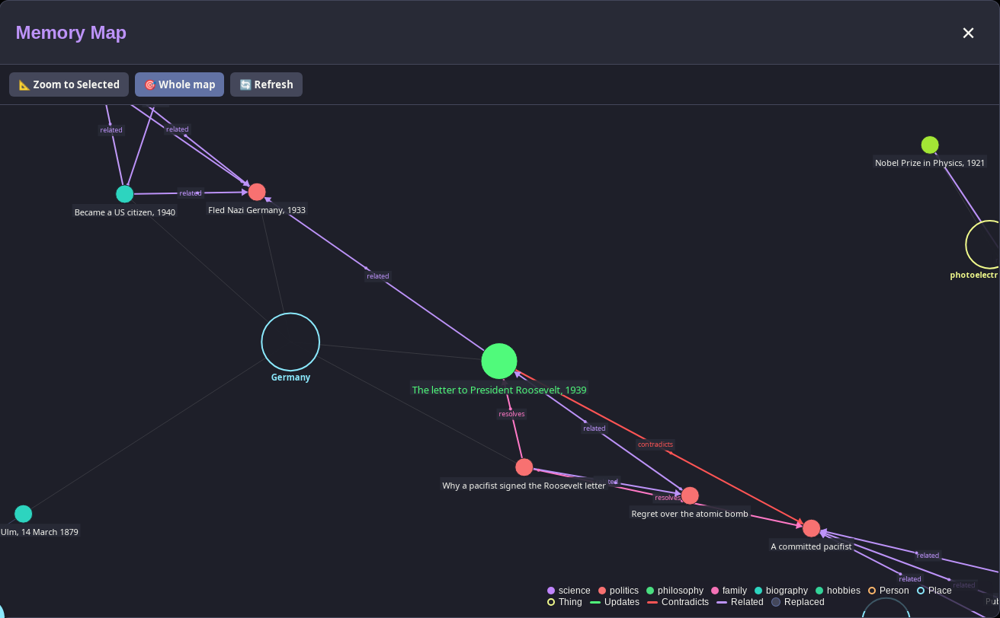

# Memory Relationship Graph

*Checked against the code on 2026-11-10 (`v1`, a7599eb).*

Zynkbot keeps more than a list of memories. Each memory can carry links to others: what it updates, what it contradicts, what it is related to, what came out of the same message. The chat uses these links to know that a memory was replaced or disputed. The Memory Manager shows them in words on each memory's panel. Together they record how your understanding changed, not only what you know.

The Memory Manager's **memory map** draws them. It draws a hub for each person, place, organisation or thing that enough memories mention. On a map with fewer than 200 memories, two memories make a hub. On a larger map it takes three. At most 80 hubs are drawn, the biggest first. Memories sit around their hubs and are coloured by namespace. The links are drawn on top in colour. Facts from the same message keep a short tie to each other. A memory that has been replaced is drawn in grey.

The hubs come from the names stored for each memory in the `memory_entities` table. When a memory has no rows there, the map falls back to the name-finder's output in the memory's `entities_detected` column. A hub also takes in any memory whose text contains its name. `memory_entities` is not synced or backed up; `entities_detected` is. So the hubs can differ a little between devices. The code is `get_full_memory_graph()` in `zynkbot_rust/src-tauri/src/commands/memory.rs` and `zynkbot_rust/src/components/MemoryGraphModal.jsx`.

The rest of this document is about the links themselves: what they are, what they are used for today, and what could be done with this kind of data in the future, with your full knowledge and consent.

---

## What the Graph Represents

Each **node** is a stored memory: a fact, belief, experience, or statement you have shared with Zynkbot.

Each **edge** is a link between two memories. Four types are stored:

| Relationship | Meaning |
|---|---|
| `related` | Memory A is about the same specific subject as Memory B and adds to or confirms it |
| `contradicts` | Memory A conflicts with Memory B (you are asked which is right) |
| `updates` | Memory A replaces an older state recorded in Memory B; B is kept as history |
| `resolves` | Memory A is your own explanation of how two conflicting memories are both true |

Migration 0022 (2026-10-23) reduced the types to these four. The earlier `supports`, `elaborates` and `caused_by` links became `related`. `reminds_of`, `quotes` and `mentions` links were deleted. The database now rejects any other type. Where a passage below mentions causal links, it describes an idea, not something the app stores.

`resolves` is never chosen by the model. When you pick "Resolve with explanation" on a conflict card, your explanation is stored as a new memory and linked to both conflicting memories with `resolves`. When either memory is recalled later, the chat follows links one step out and can bring the explanation with it.

  

Each link carries a **confidence** from 0.0 to 1.0. A link made by the model carries the confidence the model stated, or 0.75 when it stated none. A link between facts from the same message carries 1.0.

**How links are made.** The graph grows as you talk:

- When a message produces a memory, a hybrid search looks for stored memories that are at least 35% similar. If there are any, the model you are chatting with classifies the link to each one.
- If nothing similar is found, no model is asked and the memory is stored without links.
- Facts stored from the same message are linked `related` to each other without a model call.
- With the on-device model, the memory is stored first and the links are worked out afterwards.

The full pipeline is in [Relationship Detection Architecture](RELATIONSHIP_DETECTION_ARCHITECTURE.md).

---

## What Your Graph Tells You Right Now

### Contradiction Detection
When something you say conflicts with something you said before, Zynkbot shows a card with five choices:

- keep the older memory
- keep the newer memory (the older one is marked as replaced and kept as history)
- say they do not actually contradict (no link is kept between them)
- accept the contradiction (both are kept, linked `contradicts`)
- resolve it with an explanation (your explanation is stored as a new memory, linked to both with `resolves`)

With a cloud or custom model, the card comes before the new fact is stored. With the on-device model, the fact is stored first and the card comes after. The on-device model is also not allowed to replace a memory on its own. When it thinks a new fact updates an old one, the card asks "Is this an update?" and you decide.

This is the most practical use of the graph today: keeping your companion's understanding of you accurate.

### Central Beliefs
In a force-directed layout, highly connected nodes are pulled toward the centre of their group. On the memory map, the hubs with the most memories are the people, places and things you talk about most.

### Isolated Knowledge
Memories with few or no links, and no hub, are things you mentioned once or areas where less has been said. These gaps can also be informative.

### Cluster Structure
Groups of tightly connected nodes show how you organise a domain. Your memories about work might form one cluster and health another, with only a few bridge memories between them. Those bridges can hold important information about you. Sometimes a connection between memories surfaces that you had never considered.

### Causal Chains (an idea, not stored today)
An earlier design had a `caused_by` link type. Following those links would trace your own account of why things happened. The type was folded into `related` in migration 0022, so the app does not record cause and effect as a separate kind of link today. A future version, or a snap-in, could add it back.

---

## Your Data Is Yours

**Every memory, link and embedding is stored in a database on your device.** No telemetry code was found in the app's source.

Your memories leave the device only in these ways, and each is something you set up:

- **ZynkSync.** Memories and links are copied to the devices you pair.
- **Encrypted cloud backup.** If you configure a storage bucket and run a backup, your memories and their links are encrypted on the device and uploaded to that bucket.
- **A cloud or custom model.** If you chat with a cloud provider or a custom endpoint, that provider receives your messages and the memories recalled for them. When a new fact is stored, the fact and the similar memories it is compared with are also sent, so the model can classify the links. With the on-device model, none of this leaves the device.

So the earlier wording of this section, that the app "has no mechanism to send it anywhere", was too strong. The accurate statement is that nothing is sent anywhere you did not choose.

The data belongs to you. You can back it up, delete memories, or do nothing with it. There is no export tool for the graph yet.

ContainAI is planning an opt-in zero-trust server for your Zynkbot's memory vault, to back up your Zynkbot or install your bot anywhere without ZynkSync. That is a plan and is not in the code. What ships today is the encrypted backup to a bucket you configure, and restore from it.

---

## Theoretical Research Value

> **The following section describes potential research applications that do not currently exist in Zynkbot.** They are included to show the kind of data your graph represents and why it is worth protecting. Any future research program would require explicit, informed, revocable consent from participants. Corporations are currently trying to build this kind of graph about you, in effect a user profile, without real consent. Forcing an unreadable EULA on people who cannot avoid companies such as Google or Meta does not fit the definition of consent.

The memory relationship graph is a different kind of dataset from most knowledge graphs. Those are built from documents, databases, or structured input. This one is built from natural conversation, so it can capture things those sources cannot:

**Belief revision over time.** Psychologists who study how people update their beliefs rely on carefully designed long-term surveys. A memory graph captures this as a side effect. Every `contradicts` link followed by a `resolves` link, and every `updates` link, is potentially a dated record of a change of mind.

**Personal causal narrative (would need a new link type).** How you connect events and consequences in your own life is hard to capture from outside. The app does not store causal links today. If a causal type were added, the chains would reflect your own explanatory model.

**Knowledge topology.** The structure of your graph, which concepts are central, which are isolated, how clusters form and connect, is a map of how you organise a domain. Two experts in the same field may have very different graphs. Two people with the same education and different conclusions may show it in the structure.

**Implicit knowledge.** Surveys capture what people say they know. Conversation captures what they actually assume. The difference is significant and hard to study at scale.

**Labeled relationship data.** The `related`, `contradicts` and `updates` labels a model applies to real human statements are the kind of annotated data that relationship-extraction research needs. It is expensive and less natural to produce by human annotation alone.

Mental health experts might have many more ideas which would never occur to me.

---

## Volunteer Research Participation (Theoretical)

A future Zynkbot research program could allow users to voluntarily contribute anonymized graph data to research. This would be strictly opt-in, revocable at any time, limited to specific research questions the user agrees to, and governed by the same data sovereignty principles as the rest of the application. None of it exists today.

Some research directions this kind of dataset could support:

- **Belief revision patterns** across different demographics or cultural backgrounds
- **Misinformation markers.** Does the graph of someone who holds a false belief look structurally different from that of someone who holds a true one?
- **Expertise structure.** How does a domain expert's graph differ from a novice's in the same domain?
- **Cognitive resilience.** Do people with more densely connected, well-resolved graphs report better mental clarity or decision-making?
- **Opinion evolution.** How do major life events, reading, or conversations change someone's graph over months or years?

None of this requires surveillance. It requires volunteers who understand the value of what they hold and choose to share it on their own terms.

---

## Snap-In Concepts

The following are ideas for snap-ins that could be built on the graph. None of them exists today. Where an idea needs a link type the app does not store, that is said.

### Belief Consistency Auditor
Periodically looks through your graph for unresolved contradictions by life domain and gives a short report: *"In the last 30 days you have updated 3 beliefs about your health habits. Two remain unresolved."* Useful for anyone trying to keep a coherent picture of themselves: therapists, coaches, people doing deliberate self-improvement work.

### Symptom Pattern Tracker
Searches your memory history for recurring health mentions (pain, fatigue, headaches, digestive issues) and looks for entries that occur with them. *"You've mentioned headaches 9 times over the past 6 weeks, most often in entries that follow poor sleep or high-stress workdays."* Useful before a doctor's visit, or for noticing what you would otherwise miss across months of scattered notes.

### Cognitive Shift Journal
Traces how your beliefs changed over time by following `contradicts` then `resolves` chains, and `updates` links. Produces a readable timeline: *"Six months ago you believed X. After [event], you updated to Y, then refined that to Z."* Your intellectual autobiography, assembled from a record you made without setting out to make one.

### Fitness Consistency Monitor
Tracks stated workout goals against reported activity over time. Notices when you have gone off plan, how long gaps usually last, and whether you tend to restart after particular kinds of events. It needs no formal log and works from what you mention in conversation. *"You have noted three separate restarts of your running routine this year, each following a gap of about two to three weeks."*

### Causal Chain Explorer (needs a link type the app does not store)
Would extract and draw causal chains in your graph, grouped by domain: why you ended up in your career, why a relationship changed, what sequence of events led to a current situation. The app has no causal link type today (`caused_by` was folded into `related`). This snap-in would need one added, or would have to infer cause from `related` links and dates.

### Sleep Quality Correlator
Looks at the `related` links and dates around sleep memories to find what else tends to appear on nights you reported sleeping badly: late work sessions, alcohol, anxiety, gaps in exercise. Produces a personal list of correlations rather than generic advice. The earlier `caused_by` and `reminds_of` types this idea was first written around are no longer stored.

### Knowledge Gap Detector
Finds memories with unusually few links or very low confidence and suggests them as areas worth exploring. *"You have mentioned financial planning 14 times but it connects to almost nothing else in your graph. It appears to stand apart from your other goals."* Useful for learning programs, personal development, or spotting blind spots.

### Values-Behavior Consistency Tracker
Surfaces `contradicts` links between memories that state a value or intention and memories that describe what you actually did. *"In March you noted that work-life balance was a priority. Since then your entries include 11 references to working late or weekend sessions."* Not a judgment, a mirror. The gap between what we say we care about and how we spend our time is useful to see clearly, and hard to see without a record.

---

## Technical Reference

For developers and researchers working with the graph data directly.

**Tables.** Nodes are rows in `memories`. Edges are rows in `memory_links`. The columns are listed in [DATABASE_SCHEMA.md](DATABASE_SCHEMA.md) and are not repeated here. The names the map's hubs are built from are in `memory_entities` (migration `0011_memory_time_tags_entities.sql`) and in the `entities_detected` column of `memories`. Conflict cards are rows in `memory_cards` (migration `0024_memory_cards.sql`).

**Link types.** `relation_type` is one of `related`, `contradicts`, `updates`, `resolves`. Anything else is rejected by the table and by `create_memory_link()` in `zynkbot_rust/src-tauri/src/memory.rs`.

**Who made a link.** `created_by` is one of:

| Value | Meaning |
|---|---|
| `llm` | Classified by a cloud or custom model |
| `local_llm` | Classified by the on-device model |
| `same_message` | The two facts came from the same message |
| `user` | Your choice on a conflict card, your explanation, or a link you made yourself |
| `system` | The column default; also the links in the built-in Einstein demo set |

**Embeddings.** 384-dimensional vectors from all-MiniLM-L6-v2.

**Graph format for export.** The graph can be represented as a standard directed property graph. Export to GraphML, JSON-LD, or Cypher (Neo4j) would be a natural target for a future snap-in or CLI tool. No export exists today.

**Relationship detection pipeline.** See [Relationship Detection Architecture](RELATIONSHIP_DETECTION_ARCHITECTURE.md) for how links are made, and [Memory Processing Pipeline](MEMORY_PROCESSING_PIPELINE.md) for the pipeline around it.

---

*The relationships are an early-stage implementation. See [ROADMAP.md](../ROADMAP.md) for planned work. Links travel between your devices by ZynkSync. Since 2026-11-09 they are also in the encrypted cloud backup, and a restore puts them back by matching the memory text.*
